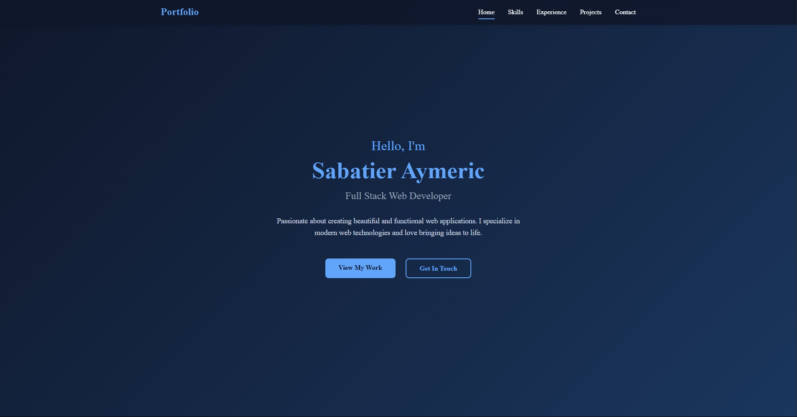

# Portfolio – Aymeric Sabatier

Portfolio personnel de développeur web Full Stack, basé à Grenoble.

🔗 **En ligne : [www.aymeric-sabatier.fr](https://www.aymeric-sabatier.fr)**



## Contenu

- **Accueil** – présentation
- **Compétences** – technologies maîtrisées, classées par niveau
- **Expérience** – parcours professionnel et formation
- **Projets** – projets professionnels et personnels, filtrables, avec galerie d'images
- **Services** – prestations de création de sites web
- **Contact** – formulaire d'envoi d'email (EmailJS) et liens vers mes réseaux

## Stack

- React 18 + TypeScript
- React Router
- CSS (sans framework)
- [EmailJS](https://www.emailjs.com/) pour le formulaire de contact
- Déploiement automatique sur GitHub Pages via GitHub Actions

## Lancer le projet

```bash
npm install
npm start      # serveur de développement sur http://localhost:3000
npm run build  # build de production dans /build
```

## Déploiement

Chaque push sur `main` déclenche le workflow [`.github/workflows/deploy.yml`](.github/workflows/deploy.yml), qui build le site et le publie sur GitHub Pages.

## Contact

- LinkedIn : [aymeric-sabatier](https://www.linkedin.com/in/aymeric-sabatier-916613279)
- Email : ssabatieraymeric@gmail.com
